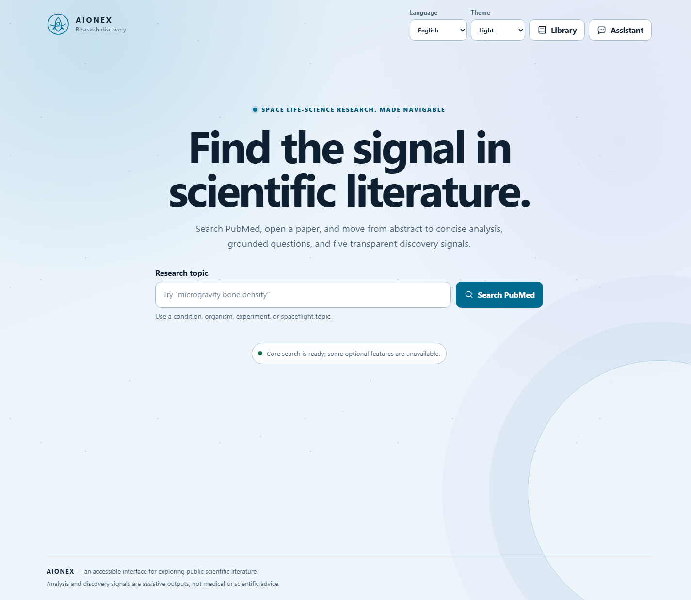
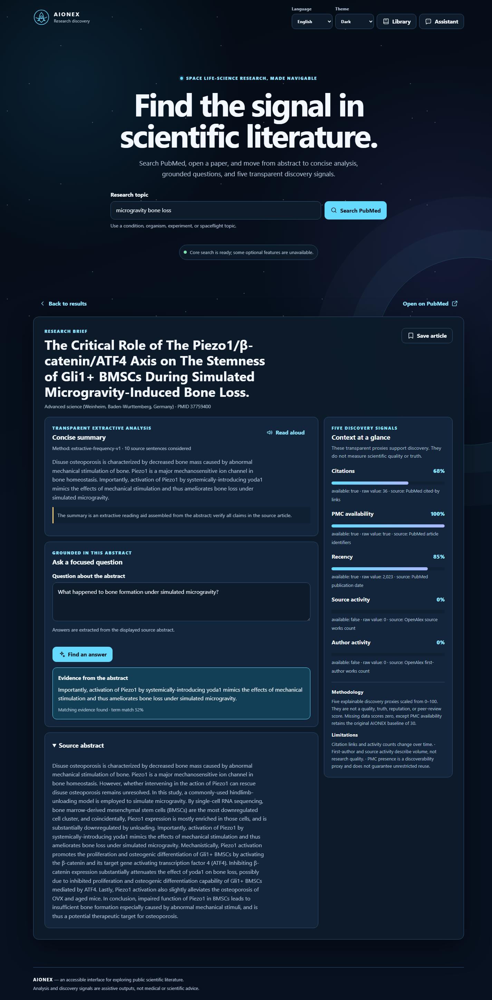
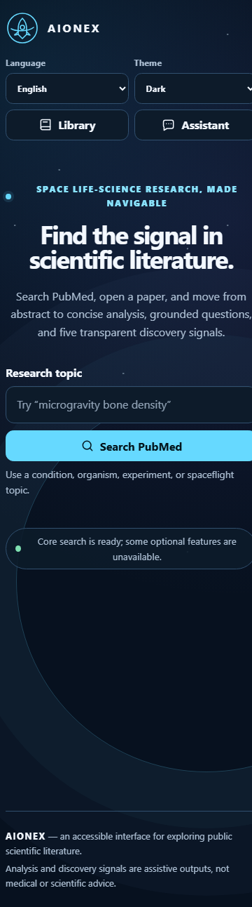
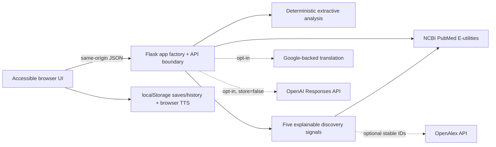

# AIONEX — Space Life-Science Research Discovery

AIONEX is an accessible research interface that turns a PubMed query into a focused reading workflow: relevant papers, an extractive abstract brief, evidence-sentence Q&A, and five transparent discovery signals.

**Release:** `1.0.0` · **Runtime:** Python 3.10+ · **Creator:** AIONEX · **Status:** private rights-review release



## Why AIONEX exists

Space life-science literature is technically public to search but difficult to navigate. AIONEX keeps the useful parts of the original competition prototype—the cosmic identity, PubMed workflow, multilingual interface, local library, and five-signal scoring model—while making the product safer, faster, explainable, and practical to run.

The core experience needs no AI key and downloads no model:

1. Search live PubMed records through NCBI E-utilities.
2. Open a paper and retrieve its source abstract.
3. Read a deterministic extractive summary.
4. Ask a focused question and retrieve the best matching evidence sentence.
5. Inspect five discovery proxies with raw values, sources, methodology, and limitations.
6. Save papers and recent searches locally in the browser.

The summary, Q&A, and signals are reading aids—not medical advice, scientific conclusions, truth ratings, or measures of research quality.

## Product evidence

| Desktop research brief | Mobile dark theme |
| --- | --- |
|  |  |

These screenshots were captured from the running `1.0.0` application at 1440 × 1000 and 375 × 812 pixels. See [validation evidence](docs/VALIDATION.md).

## Quick start

```bash
python -m venv .venv
```

Activate the environment:

```powershell
# Windows PowerShell
.\.venv\Scripts\Activate.ps1
```

```bash
# macOS / Linux
source .venv/bin/activate
```

Install the exact resolved production set, copy the safe example configuration, and start the server:

```bash
python -m pip install -r requirements.lock
cp .env.example .env
python app.py
```

On Windows, replace the copy command with `Copy-Item .env.example .env`. Open `http://127.0.0.1:5000`.

No key is required for PubMed search, article retrieval, extractive analysis, Q&A, local saves/history, or text-to-speech.

## Configuration

All optional network features are off by default.

| Variable | Default | Purpose |
| --- | --- | --- |
| `AIONEX_HOST` | `127.0.0.1` | Bind address. Keep loopback unless a deployment is intentionally secured. |
| `AIONEX_PORT` | `5000` | HTTP port. |
| `AIONEX_TRUSTED_HOSTS` | loopback names | Accepted HTTP Host values. |
| `AIONEX_CORS_ORIGINS` | empty | Explicit comma-separated cross-origin allowlist. |
| `AIONEX_RATE_LIMIT` | `60` | Requests per minute, per client and endpoint, per process. |
| `PUBMED_EMAIL` | empty | Contact address recommended by NCBI for tool identification. |
| `NCBI_API_KEY` | empty | Optional NCBI key for higher E-utilities throughput. |
| `OPENALEX_API_KEY` | empty | Enables stable-ID source/author activity signals. |
| `AIONEX_TRANSLATION_ENABLED` | `false` | Enables content translation after installing the translation extra. |
| `AIONEX_CHAT_ENABLED` | `false` | Enables optional OpenAI chat when a key is also present. |
| `OPENAI_API_KEY` | empty | Server-only OpenAI credential. Never commit it. |
| `OPENAI_MODEL` | `gpt-5.6` | Responses API model used by optional chat. |

For content translation:

```bash
python -m pip install -r requirements-translation.txt
```

Translated article text is sent to a Google-backed service through `deep-translator`. Optional chat sends messages to OpenAI's Responses API with `store=false`. Do not send confidential, personal, unpublished, or regulated information to either optional provider.

## Architecture



The app factory performs no external request and loads no ML model. External calls have connect/read timeouts, bounded retries, sanitized failures, and TTL caches. See the [architecture guide](docs/ARCHITECTURE.md) and [methodology](docs/METHODOLOGY.md).

## Engineering highlights

- A small app factory and injected service boundary keep startup offline-safe and tests deterministic.
- Standard-library PubMed XML parsing replaces browser scraping and the missing parser dependency.
- Extractive analysis and evidence retrieval expose their method and limitations instead of presenting model output as certainty.
- Five discovery signals preserve the original product idea while publishing raw inputs, sources, availability, scaling, and caveats.
- Same-origin safe DOM rendering, request cancellation, strict validation, secure headers, bounded memory, and opt-in providers reduce the original attack and failure surface.

For module interfaces, tradeoffs, and failure handling, read the [technical deep dive](docs/TECHNICAL_DEEP_DIVE.md), [security model](docs/SECURITY_MODEL.md), [user flows](docs/USER_FLOWS.md), and [decision record](docs/DECISIONS/README.md).

## API surface

| Method | Route | Contract |
| --- | --- | --- |
| `GET` | `/api/health` | Local health and optional feature availability; no upstream probe. |
| `POST` | `/api/search` | PubMed search for a bounded query. |
| `POST` | `/api/analyze` | Source abstract plus extractive summary for a canonical PubMed URL. |
| `POST` | `/api/ask` | Evidence-sentence retrieval from the supplied abstract. |
| `GET` | `/api/signals/<pmid>` | Five numeric proxies plus raw details and limitations. |
| `POST` | `/api/translate` | Opt-in bounded content translation. |
| `POST` | `/api/chat` | Opt-in bounded space-research assistant. |

The legacy `/api/reputation/<pmid>` alias remains for compatibility and returns a `Deprecation` header.

## Security and privacy defaults

- Loopback-only bind and trusted-host validation.
- Same-origin API; CORS is disabled unless explicitly allowlisted.
- 64 KiB request limit, strict types/lengths, canonical PMID/URL validation.
- Per-process sliding-window rate limits and bounded TTL/LRU memory stores.
- Content Security Policy, frame denial, MIME sniffing protection, restrictive permissions policy, and no-referrer policy.
- No credential in source, browser storage, API response, screenshot, or log.
- No user account, cookie session, upload, database, analytics, or advertising code.
- Dynamic UI content is created with DOM APIs and `textContent`; untrusted `innerHTML` is not used.

Read [SECURITY.md](SECURITY.md) and the [privacy/data-flow note](docs/PRIVACY.md) before deploying beyond a local machine.

## Built for verified use

Core search and analysis run without an AI key or model download. Provider failures are bounded and visible, optional data-sharing features are disabled by default, the interface adapts across verified desktop/mobile sizes, and the automated suite covers the highest-risk contracts. This is evidence of the documented self-hosted workflow—not a security certification or a claim of multi-tenant production readiness.

## Development and verification

```bash
python -m pip install -r requirements-dev.txt
python -m ruff check .
python -m ruff format --check .
python -m pytest
node --check static/script.js
python scripts/secret_scan.py
```

CI repeats install, compile, lint, test, JavaScript syntax, current-tree secret scanning, and locked-dependency auditing. Tests use injected services and do not contact external APIs.

## Accessibility and responsive design

The interface uses native controls and dialogs, visible labels, a skip link, logical headings, live status/error regions, keyboard focus restoration, minimum 44 px targets, RTL direction, system/light/dark themes, forced-colors support, and `prefers-reduced-motion`. It has no third-party font, icon, script, splash video, custom cursor, or continuous WebGL animation.

Verified layouts: 375 × 812, 667 × 375 landscape, 768 × 1024, 1024 × 768, and 1440 × 1000 with no horizontal overflow.

## Competition origin and rights status

Originally created in response to the **“Build a Space Biology Knowledge Engine”** challenge during the 2025 NASA International Space Apps Challenge (October 4–5, 2025), and subsequently expanded independently by AIONEX.

This independent project is not affiliated with or endorsed by NASA or the NASA Space Apps Challenge. NASA identifiers and logos are not used. The historical NASA meatball “Partner Logo,” competition video, and other unverified raster assets are excluded from this release.

The original README declared MIT before the event. This repository now includes the full MIT text for original AIONEX application code, but remains private pending confirmation of contributor authority and recovery or organizer verification of the accepted 2025 Participant Terms. The challenge-linked `SB_publication_PMC.csv` is not redistributed because its source repository states no license.

See [Competition and rights clearance](docs/COMPETITION_AND_RIGHTS.md), the [license decision](docs/LICENSE_DECISION.md), and [third-party notices](THIRD_PARTY_NOTICES.md) for the evidence and precise scope.

## Contributing

Read [CONTRIBUTING.md](CONTRIBUTING.md), [SUPPORT.md](SUPPORT.md), the [community conduct policy](CODE_OF_CONDUCT.md), and the [roadmap](ROADMAP.md). Contributions must include tests, preserve source attribution, avoid unsupported scientific claims, and provide provenance/license evidence for every new asset or dataset.

## License

Except for separately identified third-party materials, original AIONEX application code is licensed under the [MIT License](LICENSE). Copyright © 2025 AIONEX and project contributors.
