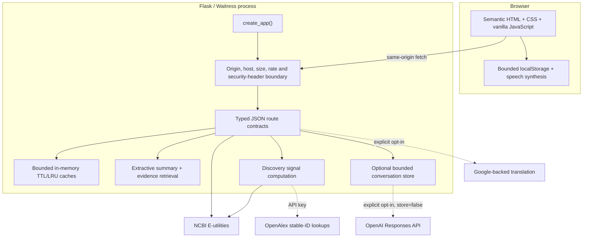
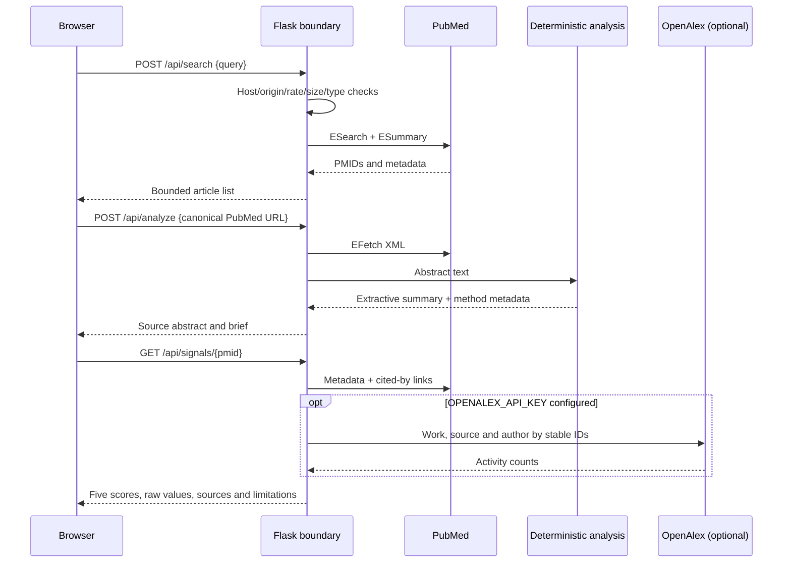

# Architecture

## Design goals

AIONEX `1.0.0` is designed around four constraints:

1. Core research discovery must start without an API key, model download, or external call during import.
2. Every external integration must be optional or fail independently.
3. Scientific assistance must remain traceable to source data and avoid quality/truth claims.
4. Browser content from users and upstream services must never enter an HTML execution sink.

## Runtime map

## Modules

| Path | Responsibility |
| --- | --- |
| `app.py` | Loads settings, creates the app, and starts Waitress on the configured host/port. |
| `aionex/__init__.py` | App factory, service assembly, request boundary, response security headers, and sanitized global errors. |
| `aionex/config.py` | Bounded environment parsing and secure defaults. |
| `aionex/http.py` | Shared Requests session, connection pooling, timeouts, safe retries, and sanitized upstream errors. |
| `aionex/cache.py` | Thread-safe bounded TTL/LRU cache and sliding-window rate limiter. |
| `aionex/api.py` | Route contracts, input validation, feature-disabled responses, and compatibility alias. |
| `aionex/services/pubmed.py` | PubMed search, ESummary metadata, EFetch XML parsing, and ELink citation retrieval. |
| `aionex/services/analysis.py` | Deterministic extractive summary and term-overlap evidence retrieval. |
| `aionex/services/signals.py` | Preserved logarithmic scaling, five proxy components, and optional stable-ID OpenAlex activity. |
| `aionex/services/translation.py` | Lazy optional content translation. |
| `aionex/services/chat.py` | Optional OpenAI Responses API call and bounded/expiring conversation history. |
| `templates/index.html` | Semantic application structure, inline authored SVG sprite, native dialogs, and live regions. |
| `static/script.js` | DOM-safe state, localization, same-origin API client, cancellation/sequencing, saves/history, TTS, and interaction logic. |
| `static/style.css` | Token-based themes, responsive layout, focus/forced-color/reduced-motion behavior, and authored cosmic ambience. |

## Request lifecycle

## Failure isolation

- Import/startup constructs clients but performs no network access.
- A PubMed search failure returns a sanitized `502`; it does not stop the process.
- PubMed citation-link failure marks only that detail unavailable.
- Missing or failed OpenAlex leaves two activity signals unavailable/zero while the other three remain useful.
- Translation and chat return explicit `503` feature-disabled responses unless opted in.
- Browser requests have timeouts, cancellation, and monotonically increasing sequence IDs so stale responses cannot replace newer state.
- Corrupt or blocked browser storage degrades to an empty local library.

## Deployment boundary

The default loopback/Waitress configuration is intended for local use or a trusted reverse proxy. A public multi-instance deployment must add distributed rate limiting, production observability with a redaction policy, TLS at the edge, explicit trusted proxy configuration, and—if paid chat is exposed—authentication/quotas. In-memory cache, rate, and conversation state are process-local by design.
