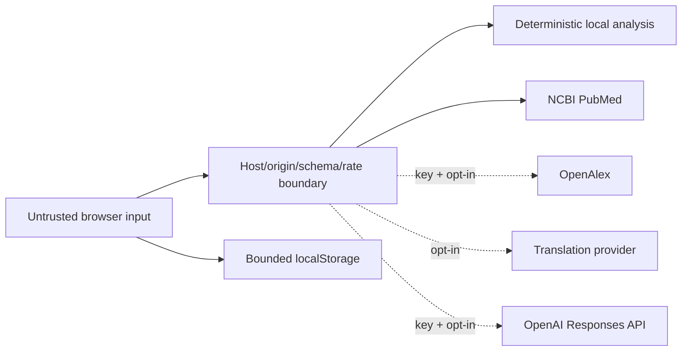

# Security model

## Scope and assumptions

AIONEX is secure by default for a trusted user running it on loopback. An operator who exposes it to a network assumes deployment duties such as TLS termination, authentication, distributed rate limiting, monitoring, and secret management. The project has no account system and does not claim multi-tenant isolation.

## Trust boundaries

Browser input, provider payloads, HTTP headers, and persisted browser records are untrusted. `.env` values are server-side secrets. Titles and abstracts are provider content and never receive HTML interpretation.

## Primary threats and controls

| Threat | Control | Residual limit |
| --- | --- | --- |
| Credential disclosure | ignored `.env`, safe example, server-only reads, secret scan, no config echo | The historical key must still be rotated by its owner. |
| DOM XSS/persisted XSS | DOM construction and `textContent`, strict canonical external URL, CSP | Future contributors must preserve the safe rendering boundary. |
| Cross-site paid/API use | same-origin default, explicit CORS allowlist, host checks, chat off by default | A deliberately broad allowlist weakens this control. |
| Resource exhaustion | 64 KiB body cap, length bounds, TTL/LRU stores, per-client endpoint limits, upstream timeouts | Limits are per process and IP-derived; use shared infrastructure for scaled deployment. |
| SSRF/open redirect | canonical PubMed URL and numeric PMID validation; external link allowlist | Optional provider endpoints are code/config controlled, not user supplied. |
| Provider/data deception | normalized contracts, availability flags, raw source details, sanitized failures | Upstream metadata can still be incomplete or wrong. |
| Clickjacking/content injection | frame denial, CSP, MIME sniffing protection, restrictive permissions/referrer policies | HSTS applies only when served over HTTPS. |
| Sensitive research leakage | optional services off; explicit notices; no server persistence | Enabling providers sends bounded content to their services. |

## Secret lifecycle

The release contains variable names only. A credential-shaped OpenAI value found in the original source was removed and preserved only in a local ignored `.env` for owner-controlled rotation; it is considered exposed and must not be used. Git history reachable from the release is scanned, but the upstream provider is the authority for revocation.

## Security verification

Automated tests exercise host/origin rejection, content types, request limits, schema validation, rate limits, disabled paid features, and response headers. CI runs lint, tests, JavaScript syntax, a current-tree secret scan, offline import, and a locked dependency audit. See [VALIDATION.md](VALIDATION.md) for exact local evidence and limitations.

Vulnerability reporting and supported versions are in [SECURITY.md](../SECURITY.md).
