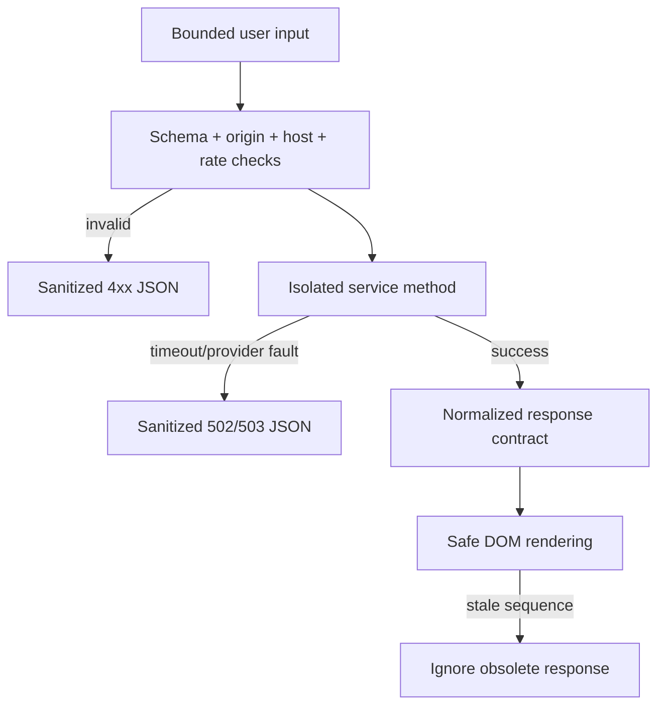

# Technical deep dive

## The engineering problem

The original prototype combined HTTP routes, provider parsing, model startup, scoring, configuration, and server launch in one module. Its most valuable product idea was worth preserving: move from a PubMed query to a compact reading workflow and retain five visible discovery signals. The release separates that workflow into testable boundaries without replacing it with a framework template.

## Request boundary

`aionex.create_app()` assembles configuration and services but performs no provider request. `aionex/api.py` owns the public JSON contracts:

- validates content type, object shape, lengths, PMIDs, and canonical PubMed URLs;
- applies endpoint/client sliding-window limits;
- maps typed provider failures to bounded, sanitized responses;
- keeps legacy `/api/reputation/<pmid>` compatibility explicit and deprecated.

The boundary is deliberately synchronous. The upstream work is short HTTP I/O, Waitress provides a bounded thread pool, and the smaller operational surface fits a self-hosted research tool better than an unneeded job system.

## Provider isolation

`aionex/http.py` configures pooled sessions, connect/read timeouts, retryable status handling, and a neutral user agent. `aionex/services/pubmed.py` translates NCBI E-utilities XML into application records with the standard library XML parser. No browser scraping or Selenium runtime remains.

PubMed search, summary/fetch, abstract fetch, and cited-by lookup are distinct methods. This keeps parsing fixtures deterministic and prevents a provider response from leaking through as an undocumented frontend contract.

## Analysis that can be explained

`aionex/analysis.py` implements two deterministic aids:

1. sentence token frequencies rank source-abstract sentences for an extractive brief;
2. normalized question/abstract token overlap selects an evidence sentence.

The returned score is a lexical term match, not probabilistic confidence. Empty abstracts and no-match questions remain explicit states. This avoids model downloads, import-time failures, hidden inference, and inflated scientific claims.

## Five-signal model

`aionex/signals.py` preserves the original five-part concept and logarithmic scaling while correcting its semantics. Citation links, PMC availability, publication recency, source activity, and first-author activity are discovery proxies on a 0–100 display scale. Raw values, availability, source, methodology, and limitations accompany every response.

OpenAlex lookups use stable work/source/author identifiers. Without an operator key, those optional activity components remain unavailable at the documented baseline rather than being guessed from ambiguous names.

## Optional-service containment

Translation and chat are opt-in feature modules. Each is lazy, bounded, and absent from the core startup path. Chat uses the Responses API, sends `store: false`, keeps only a bounded in-process TTL history, and never returns a configured key. Translation discloses that article text leaves the process.

## Browser state and rendering

The vanilla frontend is intentional: it has one same-origin script, one stylesheet, no package/build chain, and no third-party runtime. Dynamic nodes are constructed with DOM APIs and `textContent`. A monotonic sequence plus `AbortController` prevents stale search, analysis, signal, question, translation, or chat responses from replacing newer state.

Saves and history are bounded in `localStorage`; no article content is persisted by the server. Native controls/dialogs, focus restoration, live regions, RTL direction, forced-colors tokens, reduced motion, and 44 px targets form the accessibility baseline.

## Failure handling

The application does not claim that an upstream service is healthy during local `/api/health`; that route reports configuration and process readiness only. Provider errors preserve core navigation and keep optional features visibly unavailable.

## Verification seams

Services are injected into the app factory, so API tests use deterministic fakes and make no external call. Unit tests cover XML/date parsing, analysis, signal scaling, request security, rate limits, feature-off states, and the OpenAI `store: false` contract. Live read-only PubMed and real-browser evidence is recorded separately in [VALIDATION.md](VALIDATION.md).
