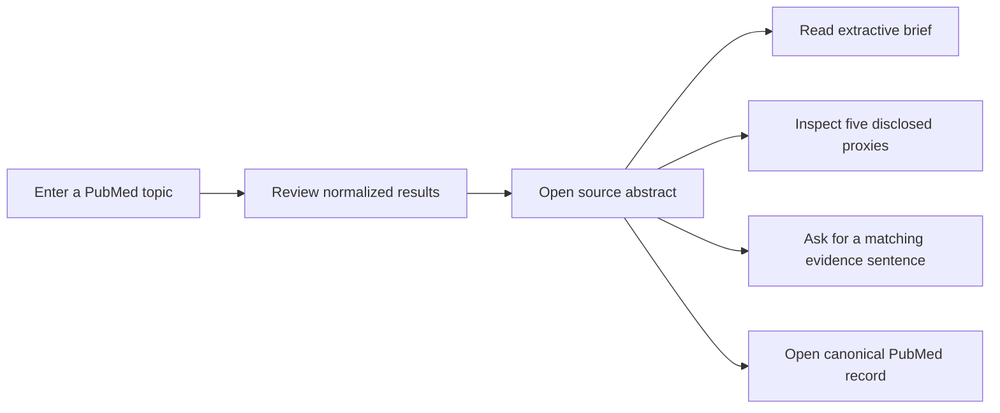

# User flows

## Discover and investigate a paper

The search remains usable without an AI, translation, NCBI, or OpenAlex key. Loading, no-result, missing-abstract, provider-failure, and stale-request states are separate. Back returns to the retained result list and scroll position.

## Save and revisit locally

Selecting **Save article** stores a bounded metadata record in the browser. **Library** exposes saved records and recent queries in a native dialog. Keyboard focus moves into the dialog, Escape closes it, and focus returns to the opening control. Clearing history asks for confirmation; no account or server database is involved.

## Change language and presentation

The language selector changes interface strings across English, Chinese, Spanish, Hindi, French, and Arabic. Arabic also changes the document direction to RTL. Theme can follow the operating system or use explicit light/dark modes. Reduced-motion and forced-colors preferences remain effective.

## Optional translation

When an operator explicitly enables translation and installs its dependency, the article translation control appears. The UI tells the user that text will be sent to a third-party service. Failure leaves the original article and core workflow intact.

## Optional assistant

The assistant control is disabled unless both the feature flag and server-side OpenAI key are present. Its dialog warns that messages may leave the system and should not contain confidential information. Conversation state is bounded and in-process; restarting the server clears it.

## Assistive-technology behavior

- A skip link reaches the main search landmark.
- Every input has a persistent visible label and associated help/error text.
- Loading and error changes use live regions without stealing focus unnecessarily.
- Results are buttons with complete accessible names.
- Article, dialog, and return transitions move or restore focus deliberately.
- Browser text-to-speech is an explicit user action and is not required to access content.
